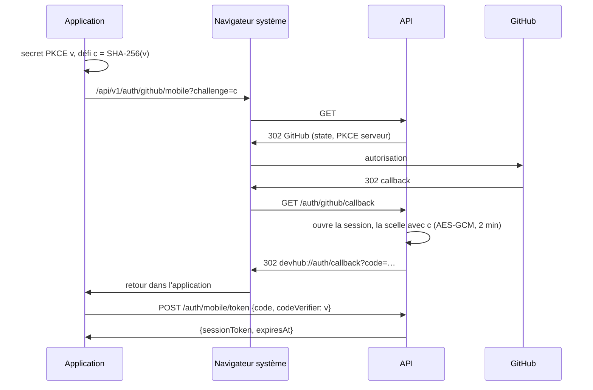

# ADR-0021 : Applications mobiles Android et iOS en Kotlin Multiplatform

- **Statut** : Proposé le 2026-11-06 (Caleb, rôle 1) ; à relire par Sylvio (front et hors ligne) et Emmanuel (sécurité)
- **Date** : 2026-11-06
- **Décideurs** : Caleb (rôle 1)
- **Exigences concernées** : après le challenge ; « application mobile native » était en roadmap (CDC v3 §3). Complète l'[ADR-0009](0009-sessions-cookie-serveur.md) (sessions) et l'[ADR-0008](0008-synchronisation-file-actions-idempotence.md) (hors ligne)

## Contexte

Le challenge est terminé. La PWA (ADR-0003) reste le client de référence, mais une application installée depuis les stores est demandée, pour Android et pour iOS, en Kotlin Multiplatform (KMP). L'API est déjà complète (environ 140 routes) ; le web compte une trentaine d'écrans.

Deux contraintes viennent de l'existant :

1. **Sessions** : l'API n'accepte une session que par le cookie `__Host-sid`, et une écriture que depuis l'origine du web avec `X-DevHub-Client: web` (protection CSRF, [10 · Sécurité](../architecture/10-securite.md)). Une application native n'a ni origine ni cookie fiable.
2. **Connexion GitHub** : le retour d'OAuth redirige vers le web. Une application doit récupérer la session sans que le jeton transite en clair par une URL.

## Options envisagées

### Interface

| Option                                          | Pour                                                                             | Contre                                                                        |
| ----------------------------------------------- | -------------------------------------------------------------------------------- | ----------------------------------------------------------------------------- |
| **Compose Multiplatform** (UI partagée)         | Une seule UI en Kotlin ; Android testable sur la machine de dev ; stable sur iOS | Rendu non natif sur iOS (proche, pas identique)                               |
| Logique partagée, UI native (Compose + SwiftUI) | Rendu iOS natif                                                                  | Deux UI à écrire et maintenir pour 30 écrans ; iOS testable seulement sur Mac |

### Session côté API

| Option                                                       | Pour                                                                       | Contre                                                        |
| ------------------------------------------------------------ | -------------------------------------------------------------------------- | ------------------------------------------------------------- |
| **Même session serveur, portée par `Authorization: Bearer`** | Révocable, même table, même durée (ADR-0009) ; aucun nouveau type de jeton | Le garde de session lit deux sources                          |
| Jeton d'API personnel (`dh_pat_`)                            | Existe déjà                                                                | Réservé au pré-vol, sans expiration glissante ; mauvais usage |
| JWT d'accès + jeton de rafraîchissement                      | Standard                                                                   | Non révocable sans liste noire ; contredit l'ADR-0009         |

## Décision

### 1. Compose Multiplatform, dans le monorepo

`apps/mobile` : un projet Gradle (hors pnpm et Turborepo), avec trois parties.

| Module       | Rôle                                                                                       |
| ------------ | ------------------------------------------------------------------------------------------ |
| `shared`     | Tout le code commun : réseau, données, hors ligne, écrans Compose, navigation, traductions |
| `androidApp` | Point d'entrée Android (`MainActivity`), manifeste, retour `devhub://`                     |
| `iosApp`     | Projet Xcode minimal qui héberge le framework `Shared`                                     |

Pile : Kotlin 2.4, Compose Multiplatform 1.12, Ktor client (OkHttp sur Android, Darwin sur iOS), kotlinx.serialization, coroutines, `lifecycle-viewmodel` et `navigation-compose` multiplateformes. Pas de framework d'injection : un graphe d'objets écrit à la main (`AppGraph`), suffisant à cette taille.

### 2. Session mobile : même session, en Bearer

- `SessionGuard` lit `Authorization: Bearer <jeton>` ; si l'en-tête est présent, lui seul compte. Un jeton préfixé `dh_pat_` reste un jeton d'API.
- `OriginGuard` accepte une écriture qui porte une session en Bearer **et** `X-DevHub-Client: mobile`. Un navigateur n'ajoute jamais `Authorization` de lui-même, et CORS refuse cet en-tête aux autres origines : pas de CSRF possible.
- La session expire comme celle du web (30 jours glissants) ; `POST /auth/logout` la révoque.
- Sur le téléphone, le jeton est chiffré : Keystore Android, Keychain iOS.

### 3. Connexion GitHub : navigateur système et PKCE (RFC 8252)

- Le code de retour est **chiffré** : le jeton n'apparaît jamais en clair dans l'URL.
- Il ne s'échange qu'avec le secret PKCE de l'application, qui ne quitte pas le téléphone : une autre application qui intercepterait `devhub://` ne peut rien en faire.
- `MOBILE_REDIRECT_URI` (défaut `devhub://auth/callback`) refuse `http(s)`, pour ne pas ouvrir de redirection.

### 4. Contrat et hors ligne

- Les DTO Kotlin reflètent `@devhub/contracts` ; le JSON est lu en ignorant les champs inconnus, pour qu'un ajout côté API ne casse pas une version publiée.
- Le hors ligne suit le contrat de [04 · Hors ligne](../architecture/04-hors-ligne-sync.md) : file d'actions locale, `Idempotency-Key` par action, `POST /sync`. Le masquage des secrets (O9) est porté en Kotlin, vérifié par les mêmes cas de test que `maskSecrets`.

### 4 bis. Hors ligne sur mobile (étape 4)

- **Stockage** : petits fichiers JSON écrits de façon atomique (okio), dans le dossier privé de l'application, un dossier par compte. Pas de base SQLite : quelques centaines d'entrées au plus, lues en entier.
- **Tout passe par la file**, en ligne comme hors ligne (04 § 2). Jusqu'à 3 actions prêtes : une à une par leur endpoint, l'`opId` en `Idempotency-Key`. Au-delà, ou si une action vise un contenu encore local : un lot `POST /sync`, où l'API résout `client:<uuid>`.
- **Types hors `/sync`** : `POST /sync` n'accepte que les types d'`ActionType` (`@devhub/contracts`). Les autres écritures des salles (`task.create`, `task.submit`, `task.complete`, `join_request.decide`) passent aussi par la file, mais toujours une à une par leur endpoint.
- **Lecture** : réseau d'abord, dernière copie en secours (profil, Passport, première page de chaque filtre SOS, 100 dernières questions consultées).
- **Hors ligne détecté** par le système (ConnectivityManager, NWPathMonitor) et confirmé par les envois : derrière un portail captif, l'application se sait hors ligne et réessaie, de plus en plus espacé.
- **Secrets** masqués par le port Kotlin de `maskSecrets` avant toute écriture sur le téléphone, avec les mêmes cas de test.
- **Pas encore** : l'écran de conflit (O4). L'application ne modifie pas encore de texte publié, donc ne peut pas créer de conflit ; un conflit éventuel s'affiche dans le centre de synchronisation.

### 4 ter. Notifications (étape 6)

- **Dans l'application** : liste, compteur de non-lues, ouverture de la question ou de la salle concernée ; le texte est construit par l'application à partir du type et du payload, comme sur le web.
- **En direct** : flux SSE `GET /api/v1/events` (ADR-0007) tant que l'application est au premier plan, coupé en arrière-plan. Reprise après coupure avec `Last-Event-ID` ; pas de durée maximale de requête, 60 s de silence (l'API envoie un ping toutes les 25 s) valent une connexion morte.
- **Messages privés** : envoyés par la file avec un type propre à l'application (`dm.create`), absent de `/sync`, donc toujours un par un ; le `clientId` empêche tout doublon.
- **Communautés : en ligne seulement.** `POST /posts` et les commentaires n'ont ni `Idempotency-Key` ni `clientId` côté API : un nouvel essai automatique après une coupure pourrait publier deux fois. Publier, commenter et voter restent donc hors de la file. Pour les passer hors ligne, il faut d'abord ajouter une clé d'idempotence à ces routes.
- **Banc d'essai** : le rapport passe par la file (`bench.report`, hors `/sync`), car tester en 2G ou hors ligne est le cas d'usage ; l'API refuse un second rapport du même testeur (`bench.already_reported`), un rejeu ne crée donc pas de doublon. Créer une demande, juger un rapport, fermer ou rouvrir restent en ligne.
- **Push système (hors de l'application)** : pas encore. Il faut côté API une table des jetons d'appareil et un envoi par FCM (Android) et APNs (iOS), donc des comptes Firebase et Apple Developer et leurs secrets. Décision à prendre dans un ADR dédié.

### 5. Livraison pas à pas

Chaque étape est une PR relue, utilisable seule :

1. **Socle** : API (Bearer et connexion mobile), projet KMP, thème, FR/EN, connexion GitHub, écran d'accueil connecté.
2. Passport et profil.
3. SOS Dev : lecture, question, réponses.
4. Hors ligne : cache de lecture, file d'actions, synchronisation, masquage.
5. Salles de projet.
6. Notifications (SSE en premier plan, puis push).
7. Découvrir, classement, règles, réglages.
8. Services écosystème.

## Conséquences

### Positives

- Une seule base de code pour les deux plateformes ; la logique et les écrans sont testés une fois.
- Aucune nouvelle table ni nouveau type de jeton côté API ; la révocation et le journal des sessions restent communs.

### Négatives

- **iOS ne se compile que sur macOS** (Xcode). Sur la machine de développement Linux, seule la partie Android est construite et testée ; la CI doit ajouter une tâche macOS pour iOS.
- Les DTO sont écrits à la main : un écart avec `@devhub/contracts` n'est détecté que par les tests. À remplacer par une génération depuis l'OpenAPI si les écarts se multiplient.
- Connexion par e-mail : `POST /api/v1/auth/email/login/mobile` et `/register/mobile` renvoient la session dans la réponse, jamais en cookie (étape 2).
