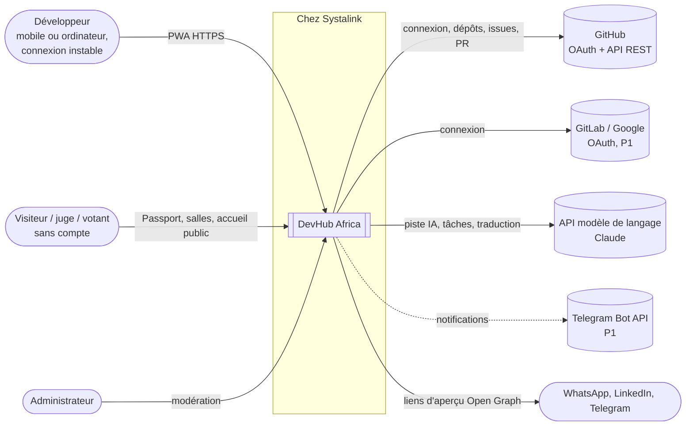
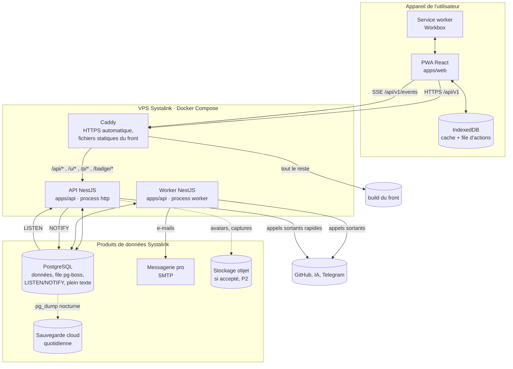
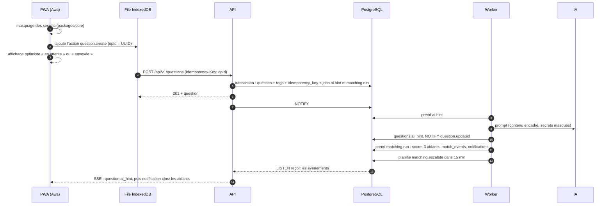
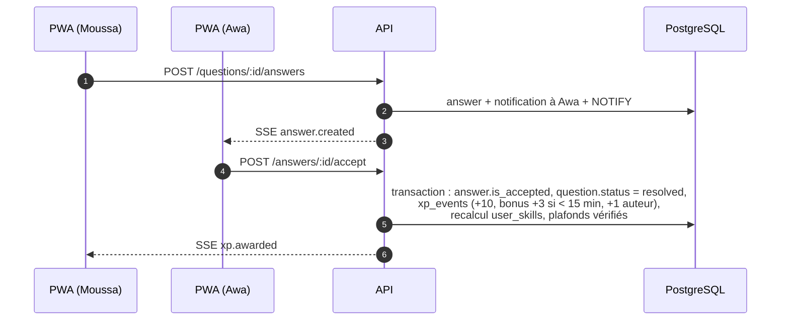
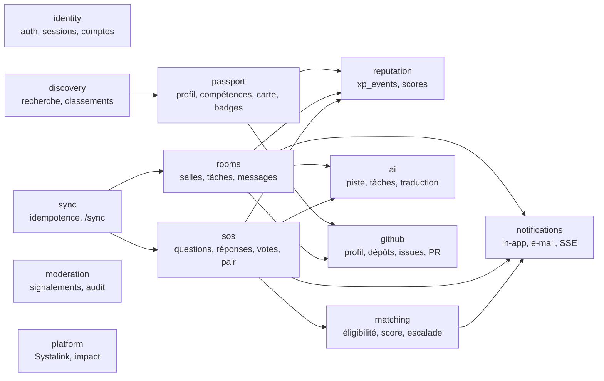

# 00 · Vue d'ensemble de l'architecture

## Le produit en une phrase

GitHub montre ce que tu as construit. DevHub Africa montre ce que tu sais faire, parce que tu l'as **prouvé** en aidant d'autres développeurs et en construisant avec eux, même avec une connexion instable.

Trois piliers pour le MVP :

| Pilier         | Module produit                 | Ce que l'architecture doit garantir                                                                                       |
| -------------- | ------------------------------ | ------------------------------------------------------------------------------------------------------------------------- |
| **Aider**      | SOS Dev                        | Une question part toujours, même si l'IA est en panne ou le réseau coupé. Les aidants sont notifiés en moins d'une minute |
| **Construire** | Salles de projet               | Les salles sont liées à un vrai dépôt GitHub, et une contribution se vérifie via l'API GitHub                             |
| **Prouver**    | Developer Passport et Proof XP | Chaque point de score remonte à un événement traçable, dans un journal où l'on ne fait qu'ajouter                         |

Deux différenciateurs pèsent sur toute l'architecture : **hors ligne d'abord**, et **hébergé chez Systalink** (40 % de la note).

## Principes directeurs

Ces principes servent à trancher quand deux options se valent. Ils sont classés par priorité.

1. **Une démo qui marche bat une architecture ambitieuse.** On choisit la solution la plus simple qui tient les critères d'acceptation. Il n'y a pas de microservices, pas de Kubernetes et pas de broker de messages.
2. **Moins de pièces à héberger.** PostgreSQL fait office de base, de file de tâches (pg-boss), de bus temps réel (LISTEN/NOTIFY) et de moteur de recherche plein texte. Un seul service de données à sauvegarder et à surveiller.
3. **Toute écriture est rejouable.** Chaque action de l'utilisateur porte un identifiant unique généré côté client. Le serveur peut la recevoir deux fois sans créer de doublon. C'est ce qui rend le hors ligne fiable (voir [04](04-hors-ligne-sync.md)).
4. **La preuve avant le déclaratif.** Les scores viennent de GitHub ou d'événements de la plateforme. Le journal `xp_events` est append-only : un abus produit un événement d'annulation, jamais une suppression.
5. **L'IA propose, elle ne décide jamais.** Une sortie de l'IA est toujours marquée comme telle et n'est jamais bloquante. Aucune action n'est créée par l'IA sans validation humaine.
6. **Un seul langage, des types partagés.** TypeScript de bout en bout : les schémas de validation sont écrits une fois dans `packages/contracts` et utilisés par le front et l'API.
7. **Aucun chiffre inventé.** Les écrans Systalink et Impact lisent des données réelles. Les comptes de démonstration sont marqués partout.

## Contexte du système (niveau C4 « contexte »)

Tout ce qui est stocké ou calculé tourne chez Systalink. Seuls l'authentification externe, GitHub et l'IA sont des services tiers, tous appelés **côté serveur**.

## Conteneurs (niveau C4 « conteneurs »)

| Conteneur      | Technologie                                       | Responsabilité                                                                                 | Propriétaire     |
| -------------- | ------------------------------------------------- | ---------------------------------------------------------------------------------------------- | ---------------- |
| **PWA**        | React + Vite, Workbox, Dexie (IndexedDB), i18next | Interface, cache de lecture, file d'actions hors ligne, synchronisation                        | Front-end        |
| **Caddy**      | Caddy 2                                           | TLS automatique, compression, en-têtes de sécurité, service des fichiers statiques, routage    | DevOps           |
| **API**        | NestJS (process `http`)                           | Endpoints REST, sessions, validation, SSE, aperçus Open Graph, badges SVG                      | Back-end         |
| **Worker**     | NestJS (process `worker`, même code)              | Jobs pg-boss : piste IA, matching, escalade, e-mails, synchronisation GitHub, sondes Systalink | Back-end, IA     |
| **PostgreSQL** | Base Systalink                                    | Source de vérité, file de tâches, bus d'événements, recherche plein texte                      | Back-end, DevOps |

L'API et le worker partagent le même code et le même schéma. Ils ne diffèrent que par le point d'entrée (`main.ts` ou `worker.ts`). Le worker peut tomber sans que l'API cesse de servir : les jobs attendent dans PostgreSQL.

## Flux de référence : le parcours de la démo

### 1. Awa pose une question (en ligne ou hors ligne)

Points clés :

- La question est enregistrée **avant** l'appel à l'IA. Si l'IA est lente ou en panne, la question part quand même aux aidants (règle S2).
- Hors ligne, l'étape 4 attend le retour du réseau. L'interface affiche « 1 action en attente ».
- Rejouer l'étape 4 avec le même `Idempotency-Key` renvoie la réponse déjà enregistrée, sans doublon.

### 2. Moussa répond, Awa valide, les Proof XP tombent

L'attribution des Proof XP est **synchrone et dans la même transaction** que la validation. Le Passport n'est jamais en retard sur la réalité, et une validation sans XP (ou l'inverse) est impossible.

### 3. Une contribution vérifiée par GitHub (R8 + R9)

Le créateur de la salle clôt une tâche avec un lien de PR. L'API (ou le worker si GitHub est lent) appelle `GET /repos/{owner}/{repo}/pulls/{n}` : la PR doit être fusionnée, et son auteur doit être le compte GitHub du contributeur. Si c'est le cas, la tâche reçoit le badge « Vérifié par GitHub ». Sinon elle est marquée « déclarée par le créateur ». Les +15 XP sont attribués dans les deux cas, et la source est affichée.

## Vue logique : les modules métier

Le back-end est un **monolithe modulaire** : un seul déployable, découpé en modules qui correspondent aux contextes métier du cahier des charges. Le détail est dans [02 · Back-end](02-backend.md).

Les flèches indiquent qui _appelle_ qui, à travers l'interface publique du module. Aucun module ne lit directement les tables d'un autre.

## Ce qui est volontairement exclu

| Exclu                           | Pourquoi                                                                                                               | Quand le reconsidérer                                                                        |
| ------------------------------- | ---------------------------------------------------------------------------------------------------------------------- | -------------------------------------------------------------------------------------------- |
| Microservices                   | Cinq personnes, vingt jours : le coût de coordination dépasse le gain                                                  | Après le challenge, si un module a une charge très différente des autres (l'IA, par exemple) |
| Redis, RabbitMQ, Kafka          | PostgreSQL couvre la file, le temps réel et le cache à cette échelle                                                   | Au-delà de quelques milliers d'utilisateurs simultanés sur le SSE                            |
| GraphQL                         | REST et OpenAPI suffisent ; le hors ligne est plus simple avec des URL stables à mettre en cache                       | Si le front multiplie les allers-retours sur des écrans composites                           |
| Elasticsearch, base vectorielle | Le plein texte PostgreSQL (GIN) tient l'objectif « moins de 1 s » ; la recherche sémantique est en P2                  | D3 (P2) : pgvector dans la même base, pas un nouveau service                                 |
| Rendu serveur complet (Next.js) | Le cahier des charges impose une PWA React (Vite) légère ; les aperçus de partage passent par une route serveur dédiée | Si le référencement devient un objectif après le challenge                                   |
| WebSockets                      | Les échanges serveur vers client sont unidirectionnels ; le SSE passe les proxys et reprend tout seul                  | Chat temps réel bidirectionnel (roadmap Stack Spaces)                                        |

## Contraintes non fonctionnelles qui pilotent l'architecture

| Exigence (source)                                        | Conséquence d'architecture                                                                                     |
| -------------------------------------------------------- | -------------------------------------------------------------------------------------------------------------- |
| Accueil sous 300 Ko transférés, Lighthouse PWA ≥ 90 (§9) | Découpage du code par route, polices système, pas de bibliothèque de composants lourde, budgets vérifiés en CI |
| Notification en moins d'une minute (S3)                  | Jobs pg-boss traités en continu, SSE avec LISTEN/NOTIFY (Y8), repli par interrogation toutes les 30 s          |
| Piste IA en moins de 10 s, jamais bloquante (S2)         | Job asynchrone, délai maximal, cache par empreinte, quota de 10 appels par heure et par utilisateur            |
| Envoi hors ligne sans doublon (O2)                       | `Idempotency-Key` obligatoire sur toutes les écritures, table `idempotency_keys`, `client_id` unique           |
| Recherche en moins de 1 s (S6, D1)                       | Index GIN `tsvector`, index composés, pagination par curseur                                                   |
| Retrait d'un contenu en moins de 1 minute (M1)           | Masquage immédiat par colonne `hidden_at`, invalidation par SSE                                                |
| Démo récupérable (§9)                                    | Déploiement en une commande, sauvegarde nocturne et restauration testée, compte et vidéo de secours            |

## Pour aller plus loin

- [01 · Structure du monorepo](01-structure-monorepo.md)
- [Index des ADR](../adr/README.md) : le pourquoi de chaque choix ci-dessus
