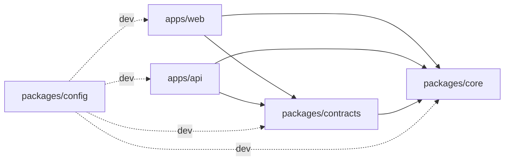

# 01 · Structure du monorepo

Un seul dépôt contient le front, l'API, le code partagé, l'infrastructure et la documentation. Gestionnaire de paquets : **pnpm workspaces**. Orchestration des tâches : **Turborepo**. Voir [ADR-0001](../adr/0001-monorepo-pnpm-turborepo.md).

Pourquoi un monorepo ici :
- Une fonctionnalité (par exemple S1, poser une question) touche le contrat, l'API et le front : **une seule PR** les change ensemble, sans désynchronisation.
- Les règles qui doivent être identiques des deux côtés (masquage des secrets, détection d'étiquettes, barème XP affiché) ne sont écrites qu'une fois.
- Une seule CI, une seule configuration TypeScript, ESLint et Prettier.

## Arborescence cible

```text
CADEV-saiyens/
├── apps/
│   ├── web/                      # PWA React (Vite) — propriétaire : front
│   │   ├── public/               # icônes, manifest, robots.txt
│   │   ├── src/
│   │   │   ├── app/              # routeur, providers, layouts, garde d'auth
│   │   │   ├── features/         # une dossier par fonctionnalité produit
│   │   │   │   ├── home/         # accueil public (T1) et accueil connecté
│   │   │   │   ├── auth/         # connexion, code de conduite (M3), onboarding (T3)
│   │   │   │   ├── sos/          # SOS Dev : poser, lire, répondre, valider
│   │   │   │   ├── rooms/        # salles, tâches, discussion
│   │   │   │   ├── passport/     # /u/:handle, preuves, carte, réglages
│   │   │   │   ├── discover/     # recherche, classement, carte d'Afrique
│   │   │   │   ├── status/       # /systalink, /impact
│   │   │   │   ├── rules/        # /regles (X5)
│   │   │   │   └── admin/        # modération
│   │   │   ├── offline/          # moteur hors ligne : Dexie, file, sync, réseau, conflits
│   │   │   ├── shared/
│   │   │   │   ├── api/          # client HTTP typé (contrats), intercepteurs
│   │   │   │   ├── ui/           # composants génériques (Button, Card, Tag…)
│   │   │   │   ├── i18n/         # configuration i18next
│   │   │   │   └── lib/          # utilitaires sans dépendance métier
│   │   │   ├── locales/          # fr/*.json, en/*.json
│   │   │   ├── sw.ts             # service worker (injectManifest Workbox)
│   │   │   └── main.tsx
│   │   ├── e2e/                  # tests Playwright (parcours SOS, hors ligne)
│   │   ├── index.html
│   │   └── vite.config.ts
│   │
│   └── api/                      # API + worker NestJS — propriétaires : back
│       ├── prisma.config.ts      # configuration Prisma 7 (URL de la base, migrations, seed)
│       ├── prisma/
│       │   ├── schema.prisma     # schéma de la base (source de vérité)
│       │   ├── migrations/       # migrations SQL générées puis relues
│       │   └── seed.ts           # étiquettes, comptes de démo marqués
│       ├── src/
│       │   ├── main.ts           # point d'entrée HTTP
│       │   ├── worker.ts         # point d'entrée worker (jobs pg-boss)
│       │   ├── app.module.ts
│       │   ├── modules/          # un dossier par module métier (voir 02)
│       │   │   ├── identity/
│       │   │   ├── passport/
│       │   │   ├── reputation/
│       │   │   ├── sos/
│       │   │   ├── matching/
│       │   │   ├── rooms/
│       │   │   ├── discovery/
│       │   │   ├── notifications/
│       │   │   ├── ai/
│       │   │   ├── github/
│       │   │   ├── sync/
│       │   │   ├── moderation/
│       │   │   └── platform/
│       │   └── infrastructure/   # transverse technique : prisma, jobs, sse, config, logs
│       └── test/                 # tests d'intégration (base PostgreSQL de test)
│
├── packages/
│   ├── contracts/                # @devhub/contracts — schémas zod + types de l'API
│   │   └── src/{common,sos,rooms,passport,sync,...}.ts
│   ├── core/                     # @devhub/core — logique pure partagée, zéro dépendance
│   │   └── src/
│   │       ├── secrets/          # motifs de détection et masquage (O9, §6.1)
│   │       ├── tags/             # dictionnaire erreur → étiquettes (S9)
│   │       ├── scoring/          # formules matching, XP, scores (testées à 100 %)
│   │       └── quality/          # jauge de qualité d'une question (S8)
│   └── config/                   # @devhub/config — tsconfig, eslint, prettier partagés
│
├── infra/
│   ├── docker-compose.yml        # production sur le VPS Systalink
│   ├── docker-compose.dev.yml    # PostgreSQL local pour le développement
│   ├── Caddyfile
│   ├── Dockerfile.api            # image API et worker
│   ├── Dockerfile.web            # build du front servi par Caddy
│   └── scripts/                  # backup.sh, restore.sh, deploy.sh
│
├── docs/                         # cette documentation + cahiers des charges
├── .github/
│   ├── workflows/ci.yml          # lint, types, tests, build, déploiement
│   ├── pull_request_template.md
│   ├── ISSUE_TEMPLATE/
│   └── CODEOWNERS
├── .claude/skills/               # skills partagés pour Claude Code
├── package.json                  # scripts racine (turbo)
├── pnpm-workspace.yaml
├── turbo.json
├── .env.example                  # toutes les variables, sans valeurs secrètes
├── CONTRIBUTING.md
└── README.md
```

## Rôle des paquets partagés

### `@devhub/contracts` : le contrat entre le front et l'API

- Contient **uniquement** des schémas [zod](https://zod.dev) et les types TypeScript qui en sont déduits (`z.infer`).
- L'API valide chaque requête avec ces schémas (via `nestjs-zod`) et en génère la documentation OpenAPI.
- Le front type son client HTTP avec les mêmes schémas, et peut valider les formulaires avec eux.
- Une modification d'un schéma casse la compilation des deux côtés en même temps : on ne découvre pas l'incompatibilité en démo.

```ts
// packages/contracts/src/sos.ts (extrait indicatif)
export const CreateQuestionBody = z.object({
  clientId: z.string().uuid(),
  title: z.string().min(10).max(150),
  body: z.string().max(10_000),
  codeSnippet: z.string().max(20_000).optional(),
  tagSlugs: z.array(z.string()).min(1).max(5),
  urgency: z.enum(['low', 'normal', 'high']),
  lang: z.enum(['fr', 'en']),
  reproUrl: z.string().url().optional(),   // S14
  roomId: z.string().uuid().optional(),    // R14
});
export type CreateQuestionBody = z.infer<typeof CreateQuestionBody>;
```

### `@devhub/core` : la logique pure partagée

- **Zéro dépendance** d'exécution, aucun accès réseau, base ou DOM. Uniquement des fonctions pures.
- Contient ce qui doit donner exactement le même résultat dans le navigateur et sur le serveur :
  - `maskSecrets(text)` : utilisée **avant la mise en file côté client** (O9) et **avant l'envoi à l'IA côté serveur** (§6.1).
  - `detectTags(errorText)` : suggestions d'étiquettes hors ligne (S9).
  - `questionQuality(draft)` : la jauge de complétude (S8), qui marche hors ligne.
  - `matchScore(...)`, `skillScore(...)`, `xpForEvent(...)` : formules du §6 et des correctifs X3 et X4, pour qu'on puisse les tester unitairement et les afficher sur `/regles`.
- C'est le paquet le plus testé du projet (objectif : 100 % des branches).

### `@devhub/config`

Configurations partagées : `tsconfig.base.json`, preset ESLint, Prettier. Chaque application les étend au lieu de les dupliquer.

## Règles de dépendance



| Règle | Pourquoi | Contrôle |
|---|---|---|
| `apps/*` ne s'importent jamais entre elles | Le front et l'API se parlent par HTTP, rien d'autre | ESLint `import/no-restricted-paths` |
| `packages/core` n'importe rien d'autre du dépôt | Reste pur et portable | ESLint + absence de dépendances dans son `package.json` |
| `packages/contracts` n'importe que `core` et `zod` | Pas de code serveur ou navigateur dans le contrat | Revue + ESLint |
| Pas de dépendance fantôme | Chaque paquet déclare ce qu'il utilise | pnpm (mode strict par défaut) |
| Pas de cycle | Graphe acyclique imposé par Turborepo | `turbo` échoue sur un cycle |

## Tâches Turborepo

| Commande racine | Effet |
|---|---|
| `pnpm dev` | Lance PostgreSQL (Docker), l'API, le worker et le front en mode développement |
| `pnpm build` | Construit `core`, `contracts`, puis `api` et `web` (ordre résolu par `dependsOn: ["^build"]`) |
| `pnpm lint` | ESLint sur tous les paquets |
| `pnpm typecheck` | `tsc --noEmit` partout |
| `pnpm test` | Tests unitaires (Vitest) de tous les paquets |
| `pnpm test:e2e` | Tests Playwright de `apps/web` contre une API locale |
| `pnpm db:migrate` | `prisma migrate dev` dans `apps/api` |
| `pnpm db:seed` | Étiquettes et comptes de démonstration |

Le cache Turborepo évite de reconstruire ce qui n'a pas changé. En CI, seuls les paquets touchés par la PR et leurs dépendants sont testés (`turbo run test --filter=...[origin/main]`).

## Versions et outillage

| Outil | Version | Remarque |
|---|---|---|
| Node.js | 24 LTS | Figée dans `.nvmrc` et dans le champ `engines` |
| pnpm | 10.34.x | Figée via `packageManager` dans `package.json` (Corepack). pnpm 12 existe, mais on garde la branche 10, éprouvée, pendant le challenge |
| TypeScript | 6.0.x, mode `strict` | `noUncheckedIndexedAccess` activé. TypeScript 7 est sorti, mais typescript-eslint ne le supporte pas encore (`<6.1`) : on le réévaluera après le challenge |
| Turborepo | 2.x | Clé `tasks` (et non plus `pipeline`) dans `turbo.json` |

Les versions exactes des bibliothèques sont figées par `pnpm-lock.yaml`, commité. Une mise à jour de dépendance est une PR `chore(deps)` à part.
