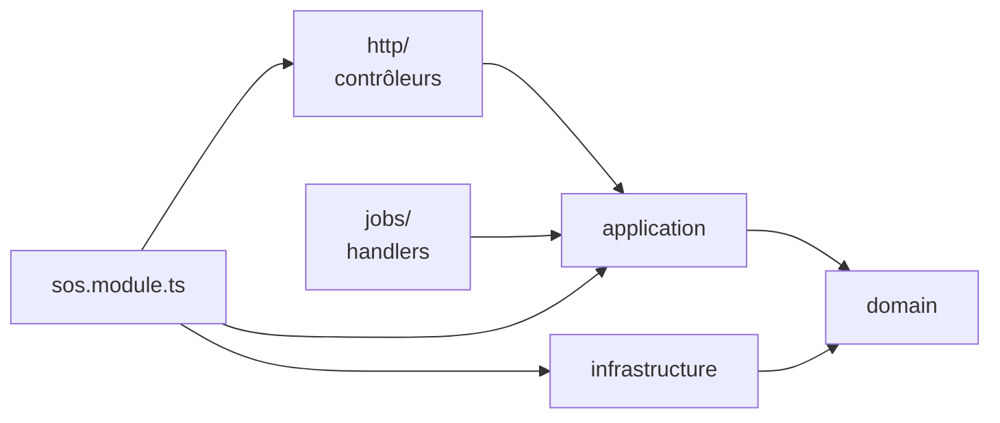

# 02 · Back-end

API et worker en **NestJS**, organisés en **monolithe modulaire**. Chaque module suit une **architecture hexagonale allégée**. Voir [ADR-0002](../adr/0002-backend-nestjs.md) et [ADR-0004](../adr/0004-monolithe-modulaire-hexagonal.md).

## Pourquoi ce découpage

Le cahier des charges décrit des contextes métier nets : SOS Dev, salles, Passport, réputation, matching… Trois développeurs back-end vont y travailler en parallèle pendant 17 jours. Le découpage doit donc :

1. **Limiter les conflits Git** : chaque développeur travaille surtout dans « ses » modules.
2. **Rendre testable la logique sensible** (matching, XP, idempotence) sans base de données ni réseau.
3. **Rester simple** : pas d'abstraction qui ne serve pas une exigence du cahier des charges.

## Les modules métier (contextes délimités)

| Module          | Responsabilité                                                                                                              | Tables possédées                                                                        | User stories                | Propriétaire |
| --------------- | --------------------------------------------------------------------------------------------------------------------------- | --------------------------------------------------------------------------------------- | --------------------------- | ------------ |
| `identity`      | OAuth GitHub, GitLab et Google, sessions, compte, suppression (A3), code de conduite (M3), confidentialité (PR14)           | `users`, `oauth_accounts`, `sessions`                                                   | A1–A3, M3, PR14, T3         | Caleb        |
| `passport`      | Profil, import GitHub, compétences, page publique, preuves, Proof Card (PR5), badge README (PR6), recommandations (PR9)     | `tags`, `user_skills`, `endorsements`                                                   | PR1–PR11                    | Caleb        |
| `reputation`    | Journal `xp_events`, barème, plafonds, annulations, recalcul des scores                                                     | `xp_events`                                                                             | X1–X4, X6, X7               | Caleb        |
| `sync`          | Idempotence, endpoint `/sync` par lot, résolution des `client_id`                                                           | `idempotency_keys`                                                                      | O2, O4                      | Florent      |
| `sos`           | Questions, réponses, votes, validation, pair programming, base de connaissance, traductions affichées                       | `questions`, `question_tags`, `answers`, `votes`, `pair_sessions`, `translations`       | S1–S16                      | Florent      |
| `matching`      | Éligibilité, score, sélection des 3 aidants, « Je m'en occupe », escalade à 15 minutes                                      | `match_events`                                                                          | S3, S11, X4                 | Florent      |
| `notifications` | Notifications dans l'application, e-mails SMTP, flux SSE, Telegram et Web Push (P1)                                         | `notifications`, `push_subscriptions`                                                   | S3, Y3, Y7, Y8              | Florent      |
| `discovery`     | Recherche de devs et de salles, classement par pays, communautés (D5)                                                       | `communities`                                                                           | D1–D7                       | Caleb        |
| `rooms`         | Salles, membres, demandes, tâches, discussion, demandes de retour                                                           | `rooms`, `room_members`, `join_requests`, `tasks`, `room_messages`, `feedback_requests` | R1–R14                      | Joachim      |
| `github`        | Adaptateur API GitHub : profil, langages, dépôts, issues, PR, cache, quota                                                  | `github_cache`                                                                          | PR1, R1, R9, R12, X3        | Joachim      |
| `ai`            | Adaptateur modèle de langage : piste, tâches de salle, traduction, fiche de résolution ; quotas, cache, gabarits de prompts | `ai_requests`                                                                           | S2, S10, S12, R5, R12, PR12 | Joachim      |
| `moderation`    | Signalements, retrait, journal d'audit, limitation du débit                                                                 | `reports`, `admin_actions`                                                              | M1, M2, M4, X8              | Emmanuel     |
| `platform`      | Écran Systalink (sondes réelles), page de statut, écran d'impact                                                            | `status_checks`                                                                         | Y1, Y2, Y5, Y6, Y9          | Emmanuel     |

La colonne « Propriétaire » est une proposition à valider (voir [organisation](../equipe/organisation.md)). Propriétaire ne veut pas dire « seul à coder » : cela veut dire « relit les PR qui touchent le module et connaît ses invariants ».

## Structure interne d'un module

```text
modules/sos/
├── domain/                       # cœur : aucune dépendance à NestJS, Prisma ou HTTP
│   ├── question.ts               # entité + invariants (statuts, transitions)
│   ├── answer.ts
│   ├── errors.ts                 # erreurs métier typées (QuestionAlreadyResolved…)
│   ├── events.ts                 # événements métier (AnswerAccepted…)
│   └── ports.ts                  # interfaces : QuestionRepository, Clock, JobQueue…
├── application/                  # cas d'usage : orchestrent le domaine via les ports
│   ├── ask-question.ts
│   ├── post-answer.ts
│   ├── accept-answer.ts
│   └── ask-question.spec.ts      # tests unitaires avec adaptateurs en mémoire
├── infrastructure/               # adaptateurs concrets des ports
│   ├── prisma-question.repository.ts
│   └── question.mapper.ts        # ligne Prisma ↔ entité du domaine
├── http/                         # adaptateur entrant HTTP
│   ├── questions.controller.ts
│   └── answers.controller.ts
├── jobs/                         # adaptateur entrant « file de tâches » (si besoin)
├── sos.module.ts                 # câblage NestJS : lie chaque port à son adaptateur
└── index.ts                      # API publique du module (ce que les autres ont le droit d'importer)
```

### Règle de dépendance



- `domain/` n'importe **rien** en dehors de lui-même et de `@devhub/core`. Ni `@nestjs/*`, ni `@prisma/client`.
- `application/` importe `domain/` (entités et **ports**) et jamais `infrastructure/`. Le cas d'usage reçoit ses dépendances par injection, typées par les ports.
- `http/` et `jobs/` ne contiennent pas de logique métier. Un contrôleur fait trois choses : valider la requête, appeler un cas d'usage, mettre en forme la réponse.
- `infrastructure/` implémente les ports. C'est le seul endroit où l'on parle Prisma ou HTTP sortant.

Cette règle est vérifiée par ESLint (`import/no-restricted-paths`) dans la CI.

### Le juste niveau d'abstraction

L'hexagonal pur sur 13 modules en 17 jours serait trop coûteux. Règle pragmatique :

| Type de module                                                                  | Niveau d'architecture                                                                                                                    |
| ------------------------------------------------------------------------------- | ---------------------------------------------------------------------------------------------------------------------------------------- |
| **Logique riche et risquée** : `sos`, `matching`, `reputation`, `sync`, `rooms` | Hexagonal complet : domaine, ports, cas d'usage, tests en mémoire                                                                        |
| **Adaptateurs de services externes** : `github`, `ai`, `notifications`          | Un port (`GithubPort`, `LlmPort`, `MailerPort`) et un adaptateur. Un faux adaptateur pour les tests et la démo hors ligne                |
| **Lecture et agrégation** : `discovery`, `platform`, la lecture du Passport     | Requêtes directes dans un service de lecture, sans entité de domaine. C'est du CQRS léger : on ne modélise pas ce qu'on ne fait que lire |
| **CRUD simple** : `moderation`, réglages du profil                              | Service NestJS + Prisma, sans couche de domaine                                                                                          |

## Exemple complet : valider une réponse (S4)

```ts
// modules/sos/domain/ports.ts
export interface QuestionRepository {
  findById(id: QuestionId, tx?: Tx): Promise<Question | null>;
  save(question: Question, tx?: Tx): Promise<void>;
}
// Implémenté par AwardXp, exporté par modules/reputation (index.ts).
export interface ReputationPort {
  acceptedAnswer(
    input: {
      answerId: string;
      questionId: string;
      helperId: string;
      authorId: string;
      tagIds: string[];
      minutesToAccept: number;
    },
    tx?: unknown,
  ): Promise<AwardResult>;
}
export interface UnitOfWork {
  run<T>(work: (tx: Tx) => Promise<T>): Promise<T>;
}
```

```ts
// modules/sos/application/accept-answer.ts
export class AcceptAnswer {
  constructor(
    private readonly uow: UnitOfWork,
    private readonly questions: QuestionRepository,
    private readonly reputation: ReputationPort,
    private readonly events: DomainEventPublisher,
    private readonly clock: Clock,
  ) {}

  async execute(cmd: { questionId: QuestionId; answerId: AnswerId; actorId: UserId }) {
    return this.uow.run(async (tx) => {
      const question = await this.questions.findById(cmd.questionId, tx);
      if (!question) throw new NotFound('question');

      // Invariants dans l'entité : seul l'auteur valide, pas sa propre réponse, une seule fois.
      const accepted = question.accept(cmd.answerId, cmd.actorId, this.clock.now());
      await this.questions.save(question, tx);

      // XP dans la même transaction : jamais de validation sans XP, ni l'inverse.
      const award = await this.reputation.acceptedAnswer(
        {
          answerId: accepted.answerId,
          questionId: question.id,
          helperId: accepted.helperId,
          authorId: question.authorId,
          tagIds: question.tagIds,
          minutesToAccept: accepted.minutesSinceQuestion,
        },
        tx,
      );

      // Effets secondaires asynchrones : notification, fiche de connaissance (S12)…
      await this.events.publish(new AnswerAccepted(question.id, accepted.answerId, award), tx);
      return { question: question.toSnapshot(), xp: award };
    });
  }
}
```

Le test unitaire de ce cas d'usage tourne avec un `InMemoryQuestionRepository`, un faux `ReputationPort` et une horloge fixe, sans base de données.

### API publique du module `reputation` (disponible depuis le 8 octobre)

`AwardXp` (exporté par `modules/reputation`) : `acceptedAnswer`, `helpfulVote`, `taskCompleted`, `codeReviewGiven`, `projectDemoShared`, `revert`. Chaque méthode accepte la transaction Prisma de l'appelant (`tx`) et renvoie `{ events, withheld }`, où `withheld` explique ce qui n'a pas été attribué (`self`, `already_awarded`, `daily_cap`, `pair_weekly_limit`, `voter_too_new`, `vote_cap`). `helpfulVote` rejette `SelfVoteError` (`403 xp.self_vote`).

## Communication entre modules

Deux mécanismes, et seulement deux :

### 1. Appel synchrone par port (même transaction)

Quand la cohérence doit être **immédiate** : attribution d'XP à la validation, vérification d'appartenance à une salle avant de poster un message.

- Le module appelant déclare le port dans son `domain/ports.ts` (« ce dont j'ai besoin »).
- Le module appelé l'implémente et l'exporte dans son `index.ts`.
- Le `UnitOfWork` transmet la transaction Prisma (`tx`) pour que tout soit atomique.

### 2. Événement métier → job pg-boss (asynchrone)

Quand l'effet peut arriver **quelques secondes plus tard** et ne doit pas faire échouer l'action principale : piste IA, matching, e-mails, notifications, synchronisation GitHub, fiche de résolution.

- Le cas d'usage publie un événement (`QuestionAsked`, `AnswerAccepted`, `TaskCompleted`…).
- Le `DomainEventPublisher` l'écrit comme job pg-boss **dans la même transaction** (boîte d'envoi transactionnelle) : si la transaction échoue, aucun job n'existe ; si elle réussit, le job sera forcément traité.
- Le worker consomme le job et appelle le cas d'usage du module concerné.

| Événement         | Émis par   | Jobs déclenchés                                                                              |
| ----------------- | ---------- | -------------------------------------------------------------------------------------------- |
| `QuestionAsked`   | sos        | `ai.hint`, `matching.run`, `notifications.fanout`                                            |
| `AnswerPosted`    | sos        | `notifications.fanout`, `matching.mark-answered`                                             |
| `AnswerAccepted`  | sos        | `notifications.fanout`, `ai.resolution-sheet` (S12), `sos.still-resolved-check` (S15, +24 h) |
| `MatchCreated`    | matching   | `notifications.fanout`, `matching.escalate` (+15 min)                                        |
| `RoomCreated`     | rooms      | `github.verify-repo` si l'API était lente à la création                                      |
| `TaskCompleted`   | rooms      | `github.verify-pr` (R9), `notifications.fanout`                                              |
| `UserSignedUp`    | identity   | `github.import-profile`, `passport.recompute-skills`                                         |
| `ContentReported` | moderation | `notifications.admin`                                                                        |

**Interdit** : qu'un module lise ou écrive directement les tables d'un autre module. Exception tolérée et documentée : les **requêtes de lecture** de `discovery` et `platform` peuvent joindre plusieurs tables (elles ne modifient rien).

## Infrastructure transverse (`src/infrastructure/`)

| Dossier          | Contenu                                                                                                                          |
| ---------------- | -------------------------------------------------------------------------------------------------------------------------------- |
| `config/`        | Chargement et validation zod des variables d'environnement au démarrage. L'application refuse de démarrer si une variable manque |
| `prisma/`        | `PrismaService`, implémentation du `UnitOfWork`, extension de journalisation des requêtes lentes                                 |
| `jobs/`          | Client pg-boss, `DomainEventPublisher`, enregistrement des handlers dans `worker.ts`                                             |
| `realtime/`      | Connexion `LISTEN`, registre des connexions SSE, `RealtimePublisher` (voir [07](07-taches-fond-temps-reel.md))                   |
| `http/`          | Filtre d'exceptions (format `problem+json`), intercepteur d'idempotence, garde de session, en-têtes                              |
| `security/`      | Limitation du débit, CSRF (vérification de l'origine), chiffrement des jetons OAuth                                              |
| `observability/` | Logs JSON (pino) avec identifiant de requête, endpoint `/healthz` et `/readyz`                                                   |

## Gestion des erreurs

- Le domaine lève des **erreurs métier typées** (`DomainError` avec un `code` stable, par exemple `question.already_resolved`).
- Le filtre d'exceptions global les traduit en réponses HTTP au format **RFC 9457 `application/problem+json`** (voir [06](06-api.md#erreurs)).
- Les erreurs inattendues renvoient un 500 générique, sans détail interne, et sont journalisées avec l'identifiant de requête.
- Le front traduit les `code` en messages FR et EN : le serveur ne renvoie jamais de texte destiné à l'utilisateur.

## Configuration (variables d'environnement)

Toutes les variables sont listées dans [`.env.example`](../../.env.example) et validées au démarrage. Les plus importantes :

| Variable                                                            | Usage                                             |
| ------------------------------------------------------------------- | ------------------------------------------------- |
| `DATABASE_URL`                                                      | PostgreSQL Systalink                              |
| `APP_URL`, `API_URL`                                                | URL publiques (OAuth, liens d'e-mails, aperçus)   |
| `SESSION_SECRET`                                                    | Signature du cookie de session                    |
| `TOKEN_ENCRYPTION_KEY`                                              | Chiffrement AES-256-GCM des jetons OAuth au repos |
| `GITHUB_CLIENT_ID`, `GITHUB_CLIENT_SECRET`                          | OAuth GitHub (scopes `read:user user:email`)      |
| `LLM_API_KEY`, `LLM_MODEL`, `LLM_HOURLY_QUOTA_PER_USER`             | IA côté serveur (10 par défaut)                   |
| `SMTP_HOST`, `SMTP_PORT`, `SMTP_USER`, `SMTP_PASSWORD`, `MAIL_FROM` | Messagerie pro Systalink                          |
| `PROCESS_ROLE`                                                      | `http` ou `worker`                                |

## Conventions de code back-end

- Un cas d'usage = une classe = un fichier, nommé par un verbe (`AcceptAnswer`, `TakeTask`).
- Les identifiants sont des types marqués (`type QuestionId = Brand<string, 'QuestionId'>`) pour éviter de confondre un `userId` et un `questionId`.
- Les dates sont en UTC (`timestamptz`) et l'heure courante passe par un port `Clock` (indispensable pour tester le bonus « moins de 15 minutes » et les plafonds quotidiens).
- Pas de `any`. Pas de logique dans les contrôleurs. Pas d'accès à `process.env` hors de `infrastructure/config`.
- Les requêtes SQL brutes (`$queryRaw`) sont autorisées pour la recherche plein texte et les agrégations, toujours paramétrées (jamais de concaténation).
