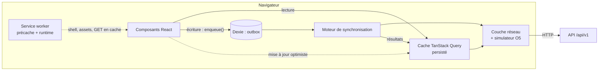
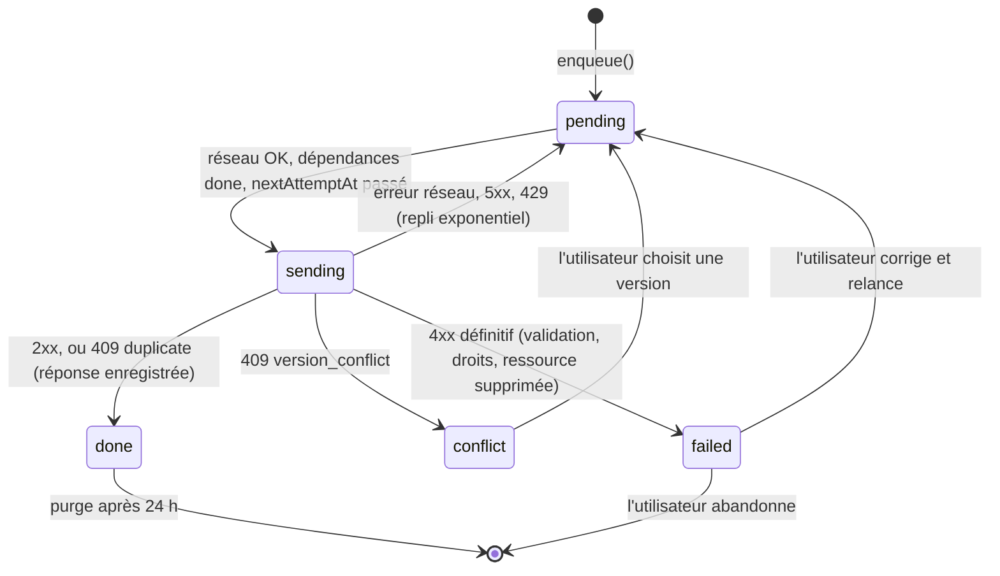
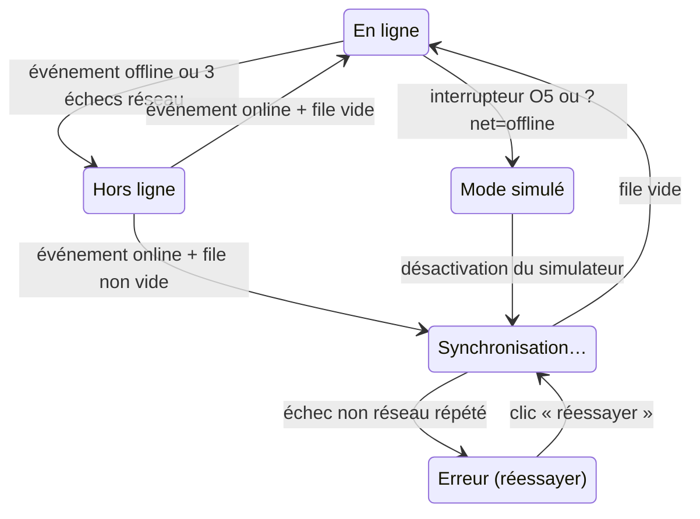

# 04 · Hors ligne et synchronisation

C'est le chantier **le plus risqué et le plus distinctif** du projet (§10, §14). Ce document est le **contrat entre le front et le back**. Le cahier des charges demande que les rôles 2 et 3 le figent dès les premiers jours. Toute modification passe par une PR relue par un back-end et par le front-end. Voir [ADR-0008](../adr/0008-synchronisation-file-actions-idempotence.md).

## Exigences couvertes

| ID  | Exigence                                                                            | Section                                                                               |
| --- | ----------------------------------------------------------------------------------- | ------------------------------------------------------------------------------------- |
| O1  | Lire sans réseau le shell, les 100 derniers contenus et mon Passport                | [Cache de lecture](#1-cache-de-lecture)                                               |
| O2  | Rédiger questions, réponses et messages sans réseau ; envoi au retour, sans doublon | [File d'actions](#2-file-dactions-outbox), [Idempotence](#3-idempotence-côté-serveur) |
| O3  | État toujours visible : en ligne, hors ligne, N en attente, synchronisation, erreur | [Indicateur réseau](#6-indicateur-réseau-et-machine-à-états)                          |
| O4  | Écran de conflit à deux colonnes (P1) ; plan B : dernière modification gagnante     | [Conflits](#5-conflits)                                                               |
| O5  | Simulateur de réseau (MVP+)                                                         | [Simulateur](#7-simulateur-de-réseau-o5)                                              |
| O8  | Centre de synchronisation (P1)                                                      | [Centre de synchronisation](#8-centre-de-synchronisation-o8)                          |
| O9  | Secrets masqués avant la mise en file, cache vidé à la déconnexion                  | [Sécurité locale](#9-sécurité-des-données-locales-o9)                                 |

## Vue d'ensemble



## 1. Cache de lecture

### Shell de l'application (service worker)

- Workbox **précache** le shell : `index.html`, JS et CSS des routes principales, polices, icônes, `manifest.webmanifest`, fichiers de traduction FR et EN. Les routes d'administration sont exclues.
- Navigation : `NavigationRoute` renvoie `index.html` depuis le précache, ce qui permet d'ouvrir n'importe quelle URL hors ligne.
- Les mises à jour du service worker sont proposées à l'utilisateur (« Nouvelle version disponible ») et ne sont jamais forcées pendant qu'il rédige.

### Contenus (TanStack Query persisté dans IndexedDB)

- Stratégie **stale-while-revalidate** : on affiche le cache tout de suite, puis on revalide si le réseau est là.
- Persistance via un `persister` écrit sur Dexie (table `query_cache`).
- **Politique de rétention** : on garde toujours mes salles, mon Passport, mes questions et mes notifications ; pour le reste, les **100 dernières ressources consultées** (LRU par date de consultation). Les listes paginées ne gardent que la première page.
- Les images (avatars) passent par le cache runtime du service worker (`CacheFirst`, 200 entrées maximum, 30 jours).
- Les réponses de l'API portent des en-têtes `ETag` sur les ressources individuelles : la revalidation coûte un `304` sans corps, ce qui économise la data.

## 2. File d'actions (outbox)

### Principe : tout passe par la file

Chaque écriture, **en ligne comme hors ligne**, devient une action dans la file. En ligne, elle part immédiatement. Un seul chemin de code, testé en permanence.

### Schéma de la table Dexie `outbox`

```ts
interface OutboxAction {
  opId: string; // UUID v4 généré à la création ; sert d'Idempotency-Key
  type: ActionType; // 'question.create' | 'answer.create' | 'room_message.create' | 'task.take' | ...
  payload: unknown; // validé par le schéma zod du contrat avant la mise en file
  refs?: ClientRef[]; // dépendances vers des entités créées hors ligne (voir plus bas)
  userId: string; // la file est propre à un utilisateur
  createdAt: string; // ISO, horloge du client (affichage uniquement)
  status: 'pending' | 'sending' | 'failed' | 'conflict' | 'done';
  attempts: number;
  nextAttemptAt?: string; // pour le repli exponentiel
  lastError?: { code: string; status?: number };
  baseVersion?: number; // pour les modifications de texte (détection de conflit)
}
```

### Types d'actions du MVP

| `type`                | Endpoint                      | Payload principal                                              | Peut créer un conflit ?                 |
| --------------------- | ----------------------------- | -------------------------------------------------------------- | --------------------------------------- |
| `question.create`     | `POST /questions`             | `clientId`, titre, corps, extrait, étiquettes, urgence, langue | Non (création)                          |
| `question.update`     | `PATCH /questions/:id`        | champs modifiés + `baseVersion`                                | **Oui**                                 |
| `answer.create`       | `POST /questions/:id/answers` | `clientId`, corps                                              | Non                                     |
| `answer.update`       | `PATCH /answers/:id`          | corps + `baseVersion`                                          | **Oui**                                 |
| `answer.vote`         | `POST /answers/:id/vote`      | —                                                              | Non (idempotent par nature)             |
| `answer.accept`       | `POST /answers/:id/accept`    | —                                                              | Non ; peut être refusée si déjà résolue |
| `room_message.create` | `POST /rooms/:id/messages`    | `clientId`, corps                                              | Non (fusion par identifiant)            |
| `task.take`           | `POST /tasks/:id/take`        | —                                                              | Peut être refusée (« déjà prise »)      |
| `join_request.create` | `POST /rooms/:id/join`        | message                                                        | Non                                     |

Les actions qui **exigent** le réseau et n'ont pas de sens hors ligne (connexion OAuth, création de salle avec vérification GitHub, appel IA explicite) ne passent pas par la file : le bouton est désactivé hors ligne avec une explication.

### Références vers des entités créées hors ligne

Awa crée une question hors ligne, puis la modifie avant d'avoir retrouvé le réseau. La seconde action ne connaît pas encore l'identifiant serveur de la question.

- Chaque création porte un `clientId` (UUID généré par le client), stocké en base dans la colonne `client_id`, **unique par auteur**.
- Une action qui dépend d'une entité non encore synchronisée l'indique dans `refs` : `{ field: 'questionId', clientId: '...' }`.
- Le moteur **n'envoie pas** une action tant que ses dépendances ne sont pas `done`. Une fois la création synchronisée, il remplace le `clientId` par l'identifiant serveur dans le payload, puis l'envoie.
- Côté serveur, `POST /sync` sait aussi résoudre une référence `client:<uuid>` parmi les entités de l'utilisateur (filet de sécurité si l'ordre est déjà dans le lot).

### Moteur de synchronisation



- **Déclencheurs** : `enqueue()`, événement `online`, retour au premier plan (`visibilitychange`), minuterie, et `sync` du service worker (Background Sync API, Android) quand elle existe.
- **Ordre** : FIFO strict par utilisateur. Une action bloquée en `conflict` ou `failed` ne bloque que les actions qui en dépendent.
- **Envoi** : action par action en ligne (latence minimale). Au retour du réseau avec plus de 3 actions en attente, envoi par **lots** via `POST /sync` (50 actions au maximum par lot).
- **Repli** : 1 s, 2 s, 4 s… jusqu'à 60 s, avec une part aléatoire de ±20 %. Le compteur repart à zéro au retour du réseau.
- **Verrou entre onglets** : un seul onglet synchronise à la fois (`navigator.locks.request('devhub-sync')`), pour ne jamais envoyer deux fois en parallèle.
- **Réconciliation** : à chaque succès, le moteur remplace l'élément optimiste du cache TanStack Query par la réponse du serveur, puis invalide les listes concernées.

## 3. Idempotence côté serveur

### En-tête `Idempotency-Key`

- **Obligatoire** sur toutes les requêtes `POST`, `PATCH` et `DELETE` des ressources utilisateur. Une requête sans cet en-tête reçoit `400 idempotency_key.missing`.
- Valeur : l'`opId` de l'action (UUID v4).
- Portée : par utilisateur. Deux utilisateurs peuvent envoyer la même clé sans interférer.

### Table `idempotency_keys`

| Colonne                            | Rôle                                                       |
| ---------------------------------- | ---------------------------------------------------------- |
| `user_id`, `key`                   | Clé primaire composée                                      |
| `endpoint`                         | Méthode et route (`POST /questions`)                       |
| `request_hash`                     | SHA-256 du corps normalisé                                 |
| `status`                           | `processing` ou `completed`                                |
| `response_status`, `response_body` | Réponse enregistrée, renvoyée telle quelle en cas de rejeu |
| `created_at`                       | Purge après 7 jours (job quotidien)                        |

### Algorithme (intercepteur NestJS)

```text
1. Lire Idempotency-Key ; absent → 400.
2. Dans la transaction de la requête :
   INSERT INTO idempotency_keys (user_id, key, endpoint, request_hash, status)
   VALUES (…, 'processing') ON CONFLICT DO NOTHING
3. Si l'insertion a eu lieu → exécuter le cas d'usage dans la même transaction,
   puis UPDATE status = 'completed', response_* = réponse. COMMIT.
4. Sinon, lire la ligne existante :
   - request_hash différent → 422 idempotency_key.reused (même clé, autre requête)
   - status = 'completed'   → renvoyer response_status + response_body, en-tête Idempotent-Replayed: true
   - status = 'processing'  → 409 idempotency_key.in_progress (le client réessaiera)
```

Parce que l'enregistrement de la clé et l'effet métier sont **dans la même transaction**, il est impossible d'avoir l'un sans l'autre. Deuxième filet de sécurité : la contrainte `UNIQUE (author_id, client_id)` sur les contenus créés.

## 4. Endpoint `POST /sync`

Traite un lot d'actions **dans l'ordre**, chacune dans sa propre transaction, avec les mêmes règles d'idempotence que les endpoints unitaires.

```http
POST /api/v1/sync
Content-Type: application/json

{
  "actions": [
    { "opId": "6f1c…", "type": "question.create", "payload": { "clientId": "a1b2…", "title": "…", "tagSlugs": ["docker"] } },
    { "opId": "7a2d…", "type": "question.update", "payload": { "questionId": "client:a1b2…", "body": "…" }, "baseVersion": 1 }
  ]
}
```

```json
{
  "results": [
    {
      "opId": "6f1c…",
      "status": "applied",
      "httpStatus": 201,
      "data": { "id": "c9e0…", "clientId": "a1b2…", "version": 1 }
    },
    {
      "opId": "7a2d…",
      "status": "applied",
      "httpStatus": 200,
      "data": { "id": "c9e0…", "version": 2 }
    }
  ],
  "serverTime": "2026-10-16T10:42:07Z"
}
```

| `status`    | Signification                                                                            | Action du client                      |
| ----------- | ---------------------------------------------------------------------------------------- | ------------------------------------- |
| `applied`   | Effectuée maintenant                                                                     | `done`, réconcilier le cache          |
| `duplicate` | Déjà effectuée lors d'un envoi précédent ; `data` contient la réponse d'origine          | `done`, réconcilier                   |
| `conflict`  | Version serveur différente de `baseVersion` ; `data.server` contient la version actuelle | `conflict`, ouvrir l'écran de conflit |
| `rejected`  | Refus définitif (`error` au format problem+json)                                         | `failed`, afficher l'erreur           |
| `skipped`   | Non traitée car une action dont elle dépend a échoué dans ce lot                         | Reste `pending`                       |

Le lot ne s'interrompt pas sur un `conflict` ou un `rejected` : seules les actions dépendantes sont `skipped`.

### Implémentation côté API (O2)

| Élément                                                     | Où                                                                                                                                                              |
| ----------------------------------------------------------- | --------------------------------------------------------------------------------------------------------------------------------------------------------------- |
| `POST /api/v1/sync` (50 actions au plus, 6 lots par minute) | `apps/api/src/modules/sync`                                                                                                                                     |
| Actions disponibles                                         | `question.create`, `question.update`, `question.claim`, `answer.create`, `answer.update`, `answer.vote`, `answer.accept` (les salles s'ajouteront avec R2 à R4) |
| Gestionnaires partagés avec les endpoints                   | `SosActions`, `MatchingActions`, enregistrés dans `ActionRegistry`                                                                                              |

- `baseVersion` au niveau de l'action est ajouté au payload pour les modifications.
- Une référence `client:<uuid>` est résolue parmi les créations du lot, puis parmi les contenus déjà synchronisés de l'utilisateur (`author_id`, `client_id`). Inconnue : `rejected` (404).
- Une action qui dépend d'une création refusée ou ignorée dans le lot : `skipped`, `httpStatus` 424, code `sync.dependency_failed`.
- Erreur passagère (429, 5xx, `idempotency_key.in_progress`) : `skipped`, le client garde l'action en attente. Erreur définitive : `rejected` avec l'erreur au format problem+json.

## 5. Conflits

| Situation                                                                                         | Règle                                                                                                                                                                                       |
| ------------------------------------------------------------------------------------------------- | ------------------------------------------------------------------------------------------------------------------------------------------------------------------------------------------- |
| Création (question, réponse, message)                                                             | Pas de conflit possible : on ajoute                                                                                                                                                         |
| Listes (messages d'une salle, tâches)                                                             | Fusion par identifiant ; **l'ordre est fixé par le serveur** (`created_at` serveur, puis `id`). Le message affiché « en attente » se replace à sa position définitive après synchronisation |
| Action sur un état qui a changé (prendre une tâche déjà prise, valider une question déjà résolue) | Refus explicite (`rejected` avec un code clair) ; l'interface explique et propose une alternative                                                                                           |
| Modification d'un texte déjà publié                                                               | Chaque contenu modifiable porte une colonne `version` (entier). La modification envoie `baseVersion`. Si `version` serveur ≠ `baseVersion` → `409 version_conflict`                         |

### Écran de conflit (O4, P1)

Deux colonnes : « Ta version (hors ligne) » et « Version en ligne », avec les différences surlignées. Trois choix : garder la mienne (renvoyée avec la nouvelle `baseVersion`), garder celle en ligne (action abandonnée), ou fusionner à la main.

### Plan B (si O4 n'est pas prêt le 15 octobre)

Dernière modification gagnante : le serveur accepte la modification et **archive l'ancienne version** dans `content_revisions`. Rien n'est perdu ; l'écran de conflit pourra être ajouté plus tard sans changer le contrat (le serveur renvoie simplement `409` au lieu d'accepter).

## 6. Indicateur réseau et machine à états



- `navigator.onLine` ne suffit pas (il dit « en ligne » derrière un portail captif). L'état « en ligne » est confirmé par une requête légère `GET /api/v1/healthz` (sans cache) à chaque transition.
- Le composant `NetworkBadge` est **toujours visible** dans le layout : « En ligne », « Hors ligne », « 2 actions en attente », « Synchronisation… », « Erreur, réessayer », « Mode simulé ».
- Hors ligne, les fonctions qui exigent le réseau affichent « en attente de connexion » (piste IA, matching) et se déclenchent automatiquement après synchronisation de la question.

## 7. Simulateur de réseau (O5)

- Interrupteur dans le menu, ou paramètre d'URL `?net=offline` / `?net=2g`.
- Implémenté dans la **couche réseau du front** (`shared/api/transport.ts`) : en mode `offline`, toute requête échoue immédiatement comme une coupure réelle ; en mode `2g`, on ajoute 800 ms de latence et on limite le débit.
- Bandeau permanent « Mode simulé » pour qu'aucun juge ne confonde simulation et coupure réelle.
- Sert aussi aux **tests Playwright** et de **plan B sur scène** si la coupure du Wi-Fi se passe mal. Le test sur un vrai téléphone reste obligatoire (Jalon 3).

## 8. Centre de synchronisation (O8)

Route `/synchronisation`. Lecture directe de la table `outbox` : type, heure, aperçu de chaque action en attente, avec possibilité de **modifier ou annuler** avant l'envoi. Après une synchronisation : « 3 envoyées, 1 conflit à résoudre » avec un lien vers l'écran de conflit.

## 9. Sécurité des données locales (O9)

- `maskSecrets()` de `@devhub/core` s'exécute **avant** l'écriture dans la file : clés AWS, jetons GitHub (`ghp_`, `github_pat_`), clés Stripe, JWT, chaînes de connexion, clés privées PEM, etc. Le texte masqué est montré à l'utilisateur avant publication (« Nous avons masqué 1 secret »).
- Le serveur réapplique le même masquage (il ne fait jamais confiance au client).
- **À la déconnexion** : suppression de la base Dexie de l'utilisateur, du cache TanStack Query persisté et des entrées runtime du service worker qui concernent l'API. Si des actions sont en attente, on prévient avant de les perdre.
- La file est **propre à un utilisateur** (`userId`) : si un autre compte se connecte sur le même appareil, il ne voit ni n'envoie les actions du précédent.

## 10. Tests du hors ligne

| Niveau          | Ce qu'on teste                                                                                                                                                              | Outil                                                                 |
| --------------- | --------------------------------------------------------------------------------------------------------------------------------------------------------------------------- | --------------------------------------------------------------------- |
| Unitaire        | Machine à états du moteur, repli, résolution des `refs`, rétention LRU                                                                                                      | Vitest + `fake-indexeddb`                                             |
| Intégration API | Rejeu d'une même clé, clé réutilisée avec un autre corps, lot `/sync` avec dépendances et conflits, concurrence (deux requêtes simultanées avec la même clé)                | Vitest + PostgreSQL de test                                           |
| Bout en bout    | Parcours de la démo : couper le réseau (`context.setOffline(true)`), écrire une réponse, recharger, vérifier « 1 action en attente », rétablir, vérifier l'unicité côté API | Playwright, en CI                                                     |
| Manuel          | Téléphone Android d'entrée de gamme, mode avion, puis 3G réelle                                                                                                             | Checklist du Jalon 3 (16 octobre), répétée trois fois avant le jour J |

## Version réduite (plan B du §14)

Si la synchronisation complète n'est pas prête au Jalon 3 : lecture hors ligne + brouillons en file + dernière modification gagnante, sans écran de conflit ni centre de synchronisation. Le **contrat d'API ne change pas**, ce qui permet d'ajouter les fonctions manquantes plus tard sans toucher au back-end.
