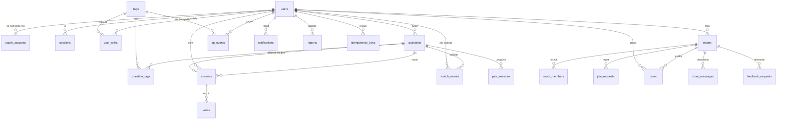

# 05 · Modèle de données

Base **PostgreSQL** chez Systalink (version 15 ou plus, à confirmer). ORM : **Prisma**. La source de vérité est [`apps/api/prisma/schema.prisma`](../../apps/api/prisma/schema.prisma) : 30 tables, schéma v1 validé par `prisma validate` avec **Prisma 7.10**. Ce document explique les choix et les invariants.

> **Prisma 7** : l'URL de connexion n'est plus dans `schema.prisma` mais dans [`apps/api/prisma.config.ts`](../../apps/api/prisma.config.ts). Le client est généré dans `apps/api/src/generated/prisma` (générateur `prisma-client`, non commité) et s'instancie avec l'adaptateur `@prisma/adapter-pg` : `new PrismaClient({ adapter: new PrismaPg({ connectionString: env.DATABASE_URL }) })`. Voir [ADR-0005](../adr/0005-postgresql-prisma.md).

## Conventions

| Convention | Règle |
|---|---|
| Nommage | Tables au pluriel et colonnes en `snake_case` dans la base ; `camelCase` côté TypeScript (via `@map`) |
| Clés primaires | UUID générés par la base (`gen_random_uuid()`), sauf tables de liaison (clé composée) |
| Dates | `timestamptz`, toujours en UTC. L'affichage dans le fuseau de l'utilisateur est l'affaire du front |
| Contenus créés hors ligne | Colonne `client_id` (UUID fourni par le client) avec `UNIQUE (author_id, client_id)` |
| Contenus modifiables | Colonne `version` (entier), incrémentée à chaque modification, pour la détection de conflits (O4) |
| Retrait par la modération | Colonne `hidden_at` : le contenu est masqué, jamais supprimé physiquement. Les requêtes publiques filtrent `hidden_at IS NULL` |
| Journaux | `xp_events` et `admin_actions` sont **append-only** : l'application n'y fait que des `INSERT` |
| Insensibilité à la casse | `handle` et `email` en `citext` (extension activée par la migration) |
| Données inventées | Interdites hors des comptes `is_demo = true`, exclus des chiffres d'impact et des classements |

## Diagramme entité-relation (cœur du MVP)



## Tables par module

### identity

| Table | Rôle | Points d'attention |
|---|---|---|
| `users` | Compte et profil public | `github_id` unique ; `privacy` (JSON, PR14) filtré **côté API** ; `can_help_tag_ids` et `want_learn_tag_ids` (PR10, 5 au maximum chacun) ; `coc_accepted_at` (M3) ; `is_demo` ; `deleted_at` pour l'anonymisation (A3) |
| `oauth_accounts` | Un compte par fournisseur (GitHub en P0, GitLab et Google en P1) | Jeton d'accès **chiffré** (`access_token_enc`, AES-256-GCM) ; scopes GitHub `read:user user:email` |
| `sessions` | Sessions serveur | L'identifiant est le **SHA-256** du jeton du cookie : une fuite de la base ne permet pas d'usurper une session |
| `communities` | Écoles, bootcamps, villes (D5, P1) | Vérification facultative par domaine d'e-mail |

Format de `users.availability` :

```json
{ "now": true, "until": "2026-10-16T18:00:00Z",
  "slots": [{ "day": 1, "from": "18:00", "to": "21:00" }] }
```

Les créneaux sont exprimés dans le fuseau `users.timezone` ; le calcul du terme D du matching les convertit en UTC.

### passport et reputation

| Table | Rôle | Points d'attention |
|---|---|---|
| `tags` | Étiquettes de technologie | `aliases` sert à la détection automatique (S9) et à la correspondance avec les langages GitHub |
| `user_skills` | Score par étiquette | `github_signal` (G), `xp_tag` (P brut), `score` = min(100, G + min(60, xp_tag)). **Table dérivée** : recalculable à tout moment depuis GitHub et `xp_events` |
| `xp_events` | Journal des Proof XP | Append-only. Une annulation crée un événement `revert` à points négatifs, lié par `reverts_id`. La contrainte `UNIQUE (user_id, kind, source_type, source_id, tag_id)` empêche un double gain |
| `endorsements` | Recommandations adossées à une preuve (PR9, P1) | `source_type` + `source_id` obligatoires ; éligibilité vérifiée par l'API |

**Invariant fondamental** : `SUM(points)` sur `xp_events` d'un utilisateur = son total de Proof XP affiché. Le Passport n'a pas de compteur stocké ailleurs qui pourrait diverger. Pour les performances, le total peut être mis en cache, mais il se recalcule toujours depuis le journal.

### sos

| Table | Rôle | Points d'attention |
|---|---|---|
| `questions` | Questions SOS Dev | `status` : `open` → `resolved` (ou `closed`) ; `ai_hint` + `ai_status` ; `accepted_answer_id` unique ; `room_id` si la question vient du « Point du jour » (R14) ; `escalated_at` |
| `question_tags` | 1 à 5 étiquettes par question | Indexée par `tag_id` pour le matching et les flux par stack |
| `answers` | Réponses | `helpful_count` dénormalisé (mis à jour avec le vote, dans la même transaction) |
| `votes` | « Réponse utile » | Clé primaire `(answer_id, voter_id)` : un vote par personne. Voter pour sa propre réponse est refusé par le cas d'usage |
| `match_events` | Journal du matching | `wave` (1 ou 2 après escalade), `score`, `regime` (`cold_start` ou `normal`, X4), `reasons` (JSON structuré, traduit par le front), `claimed_at` (S11) |
| `pair_sessions` | Créneaux de pair programming (S5, P1) | Lien de visio fourni par l'utilisateur, validé (HTTPS, liste de domaines) |
| `translations` | Traductions IA en cache (S10) | `source_hash` invalide la traduction si l'original change ; **le code n'est jamais traduit** |

Format de `match_events.reasons` (jamais de pourcentage sans méthode, §6.2) :

```json
[
  { "code": "solved_similar", "params": { "count": 5, "tags": ["docker", "nginx"] } },
  { "code": "same_timezone", "params": { "offsetHours": 0 } },
  { "code": "github_repos", "params": { "count": 4, "tag": "docker" } }
]
```

### rooms

| Table | Rôle | Points d'attention |
|---|---|---|
| `rooms` | Salles de projet | `invite_code` court et unique (URL `/p/:code`) ; `repo_full_name` vérifié via l'API GitHub (R1) ; `stack_tag_ids`, `wanted_roles` (R10) ; `last_activity_at` pour la santé du projet (R11) |
| `room_members` | Membres et rôle | Le créateur est inséré comme `owner` dans la même transaction que la salle |
| `join_requests` | Demandes pour rejoindre (R3) | Une seule demande `pending` par couple salle-utilisateur (index partiel en SQL) |
| `tasks` | Tâches | Statuts `open` → `taken` → `in_review` → `done` ; `verification` (`github_verified` ou `declared`, R9) ; `github_issue_id` unique par salle (import des issues) ; `ai_proposed` (R5) |
| `room_messages` | Discussion (R4) | Ordre fixé par le serveur : `(created_at, id)` ; `kind = standup` pour le « Point du jour » |
| `feedback_requests` | Demande de retour ou de revue de code (R6) | `confirmed_at` déclenche les +8 XP du relecteur |

### notifications, moderation, platform, technique

| Table | Rôle | Points d'attention |
|---|---|---|
| `notifications` | Notifications dans l'application | `seq` (auto-incrément) sert d'identifiant d'événement SSE et permet la reprise après coupure (`Last-Event-ID`) |
| `push_subscriptions` | Web Push et Telegram (Y7, P1) | — |
| `reports` | Signalements (M1) | Un signalement par personne et par cible |
| `admin_actions` | Journal d'audit de la modération (M4) | Append-only |
| `status_checks` | Résultats des sondes Systalink (Y1, Y5) | Purge au-delà de 30 jours |
| `idempotency_keys` | Idempotence des écritures | Purge au-delà de 7 jours (voir [04](04-hors-ligne-sync.md#3-idempotence-côté-serveur)) |
| `ai_requests` | Journal et cache des appels IA | Quota horaire par utilisateur ; cache par `(kind, input_hash, prompt_ver)` |
| `github_cache` | Cache des réponses GitHub avec `ETag` | Les requêtes conditionnelles avec `ETag` ne décomptent pas le quota quand la réponse est `304` |
| `content_revisions` | Anciennes versions (plan B des conflits) | Écrite seulement en mode « dernière modification gagnante » |

## Index

Les index déclarés dans `schema.prisma` couvrent les accès par clé et les listes triées. Les index suivants sont **ajoutés en SQL brut** dans la migration initiale, car Prisma ne sait pas les exprimer :

```sql
-- Recherche plein texte (S6, D1) : configuration « simple » pour mêler FR et EN
-- sans racinisation incorrecte ; le titre pèse plus que le corps.
ALTER TABLE questions ADD COLUMN search tsvector GENERATED ALWAYS AS (
  setweight(to_tsvector('simple', coalesce(title, '')), 'A') ||
  setweight(to_tsvector('simple', coalesce(body, '')), 'B')
) STORED;
CREATE INDEX questions_search_idx ON questions USING GIN (search);

ALTER TABLE rooms ADD COLUMN search tsvector GENERATED ALWAYS AS (
  setweight(to_tsvector('simple', coalesce(name, '')), 'A') ||
  setweight(to_tsvector('simple', coalesce(description, '')), 'B')
) STORED;
CREATE INDEX rooms_search_idx ON rooms USING GIN (search);

-- Questions sans réponse de mes stacks (S16) : index partiel
CREATE INDEX questions_open_idx ON questions (created_at DESC)
  WHERE status = 'open' AND hidden_at IS NULL;

-- Une seule demande en attente par couple salle-utilisateur (R3)
CREATE UNIQUE INDEX join_requests_one_pending
  ON join_requests (room_id, user_id) WHERE status = 'pending';

-- Le gain unique dans xp_events doit aussi valoir quand tag_id est NULL
-- (PostgreSQL 15+ : NULLS NOT DISTINCT)
DROP INDEX IF EXISTS "xp_events_user_id_kind_source_type_source_id_tag_id_key";
CREATE UNIQUE INDEX xp_events_unique_gain
  ON xp_events (user_id, kind, source_type, source_id, tag_id) NULLS NOT DISTINCT
  WHERE kind <> 'revert';

-- Recherche de devs par étiquettes (D1)
CREATE INDEX users_can_help_idx ON users USING GIN (can_help_tag_ids);
CREATE INDEX rooms_stack_idx ON rooms USING GIN (stack_tag_ids);
```

Si la base Systalink est en PostgreSQL 14 ou moins, l'index `NULLS NOT DISTINCT` est remplacé par un index sur `coalesce(tag_id, '00000000-0000-0000-0000-000000000000')`.

## Protection du journal `xp_events`

L'application ne fait que des `INSERT`, sauf le marquage `reverted_at` sur l'événement annulé. Un déclencheur l'impose au niveau de la base :

```sql
CREATE FUNCTION xp_events_guard() RETURNS trigger AS $$
BEGIN
  IF TG_OP = 'DELETE' THEN
    RAISE EXCEPTION 'xp_events est append-only';
  END IF;
  IF (NEW.user_id, NEW.kind, NEW.points, NEW.tag_id, NEW.source_type, NEW.source_id, NEW.created_at)
     IS DISTINCT FROM
     (OLD.user_id, OLD.kind, OLD.points, OLD.tag_id, OLD.source_type, OLD.source_id, OLD.created_at) THEN
    RAISE EXCEPTION 'seule la colonne reverted_at est modifiable';
  END IF;
  RETURN NEW;
END $$ LANGUAGE plpgsql;

CREATE TRIGGER xp_events_append_only
  BEFORE UPDATE OR DELETE ON xp_events
  FOR EACH ROW EXECUTE FUNCTION xp_events_guard();
```

La même protection s'applique à `admin_actions`, sans exception.

## Suppression de compte (A3)

La suppression est une **anonymisation**, pas une suppression en cascade, pour ne pas casser les fils de questions des autres :

1. `users` : `display_name = 'Compte supprimé'`, `handle = 'deleted-<8 caractères aléatoires>'`, `email`, `bio`, `avatar_url`, `country`, `timezone`, `availability`, `github_id` mis à `NULL` ou vidés ; `deleted_at = now()`.
2. Suppression des `oauth_accounts`, `sessions`, `push_subscriptions`, `notifications`, `idempotency_keys`.
3. Les questions, réponses et messages restent, attribués au compte anonymisé.
4. `xp_events` reste (journal) mais le Passport anonymisé n'est plus accessible (404).

Le traitement est un cas d'usage unique et transactionnel, testé.

## Migrations

- On utilise `prisma migrate dev` en local et `prisma migrate deploy` en production (lancé par le conteneur API au démarrage, avant d'ouvrir le port).
- Les migrations sont **commitées** et **relues** comme du code. Le SQL généré se lit avant la fusion.
- Une migration ne se modifie jamais après fusion sur `main` : on en ajoute une nouvelle.
- Avant le gel du 22 octobre, toute migration destructive (suppression de colonne, changement de type) exige l'accord du propriétaire du module et du rôle DevOps.
- `prisma/seed.ts` crée les étiquettes de référence (environ 150 technologies, avec leurs alias) et les comptes de démonstration marqués `is_demo`.

## Données de démonstration

- Les comptes de démonstration ont `is_demo = true`. Ils portent le badge « Démo » partout (§6.6).
- Ils sont **exclus** des requêtes de l'écran d'impact, du classement par pays et des compteurs de la page d'accueil publique.
- Le bac à sable de l'essai sans compte (T2) est remis à zéro chaque nuit par un job. Il ne touche que les données liées aux comptes `is_demo`.
