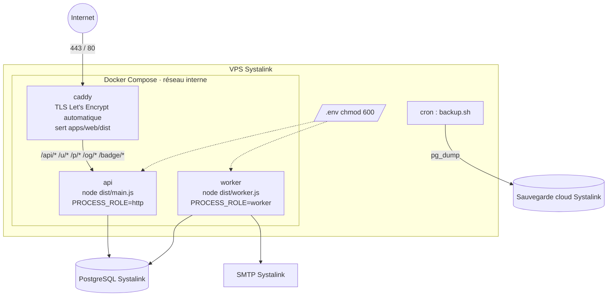
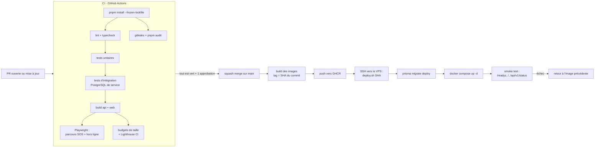

# 11 · Infrastructure et déploiement

Responsable : **rôle 4 (DevOps et sécurité)**. Tout tourne chez **Systalink** : c'est 40 % de la note, et Systalink doit être central, pas décoratif. Voir [ADR-0011](../adr/0011-deploiement-docker-compose-caddy.md).

## Produits Systalink utilisés

| Produit | Rôle | Où on le montre | Statut |
|---|---|---|---|
| **VPS** | Héberge Caddy, l'API et le worker (Docker Compose) | `/systalink`, README, démo | P0 |
| **Base de données** (PostgreSQL de préférence) | Profils, questions, salles, Proof XP, file de tâches | `/systalink`, schéma du README | P0 |
| **Sauvegarde cloud** | Sauvegarde quotidienne, restauration testée | Date de la dernière sauvegarde affichée (Y1, Y6) | P0 |
| **Messagerie pro** | E-mails SMTP de notification | Mention « Envoyé via Systalink Mail » | P1 (Y3) |
| **Stockage objet** | Avatars, captures, Proof Cards | `/systalink` | P2 (Y4), seulement si le produit figure dans la liste officielle |

**Plan B** (§8) : si la liste officielle exclut l'un de ces produits, on en utilise au moins trois de la liste officielle. La liste est à confirmer auprès de `cadev@systalink.com` (rôle 1, 6 octobre).

**Point ouvert** : si la base de données managée Systalink n'est pas PostgreSQL, ou si elle ne permet pas `LISTEN/NOTIFY` ou les extensions `citext` et `pgcrypto`, on fait tourner PostgreSQL dans Docker sur le VPS, avec la sauvegarde cloud Systalink. On le décide au plus tard le 7 octobre, car cela change le `docker-compose.yml`.

## Topologie

Seuls les ports 80 et 443 sont ouverts sur Internet, plus SSH limité aux clés de l'équipe. L'API et le worker ne sont joignables que par le réseau Docker interne.

## Routage Caddy

| Chemin | Destination | Particularités |
|---|---|---|
| `/api/v1/events` | `api:3000` | `flush_interval -1` (SSE sans tampon), pas de compression |
| `/api/*` | `api:3000` | Compression `zstd` puis `gzip` |
| `/u/*`, `/p/*` | `api:3000` | HTML avec balises Open Graph injectées |
| `/og/*`, `/badge/*` | `api:3000` | `Cache-Control: public, max-age=3600` |
| `/assets/*` | fichiers statiques | `Cache-Control: public, max-age=31536000, immutable` (noms avec empreinte) |
| `/sw.js`, `/manifest.webmanifest` | fichiers statiques | `Cache-Control: no-cache` (sinon les mises à jour ne passent pas) |
| tout le reste | `index.html` | Repli SPA |

Le fichier de référence est [`infra/Caddyfile`](../../infra/Caddyfile).

## Environnements

| Environnement | Où | Données | Déploiement |
|---|---|---|---|
| **Local** | Poste du développeur ; PostgreSQL dans Docker (`infra/docker-compose.dev.yml`) | Graines + comptes de démo | `pnpm dev` |
| **CI** | GitHub Actions ; service PostgreSQL éphémère | Données de test | À chaque push |
| **Production** (= URL de démo) | VPS Systalink | Réelles + comptes démo marqués | Automatique à chaque fusion sur `main` (CI verte) |

Il n'y a **pas d'environnement de préproduction séparé** (20 jours, un VPS). La sécurité vient de la CI, du déploiement progressif (migrations puis redémarrage), des sauvegardes et de la possibilité de revenir à l'image précédente en une commande. Si Systalink fournit un second VPS ou une seconde base, on ajoute un environnement `staging` déployé à chaque PR.

## Pipeline CI/CD

- **Concurrence** : un seul déploiement à la fois (`concurrency: production`).
- **Durée visée** : moins de 10 minutes de la fusion à la mise en ligne.
- **Gel du 22 octobre** : après le gel, le déploiement automatique reste actif mais `main` n'accepte que des PR étiquetées `fix` et approuvées par le rôle 4 (voir [workflow Git](../equipe/workflow-git.md#gel-du-code)).

## Script de déploiement (`infra/scripts/deploy.sh`)

1. `docker compose pull` des images `api` et `web` étiquetées avec le SHA.
2. `docker compose run --rm api npx prisma migrate deploy` : si la migration échoue, on s'arrête là et la version en cours continue de servir.
3. `docker compose up -d --no-deps api worker caddy`.
4. Attente de `/readyz` (60 s au maximum).
5. Smoke test. En cas d'échec : `deploy.sh <SHA précédent>` (le SHA courant est mémorisé dans `/srv/devhub/.current`).

Les migrations doivent donc être **compatibles avec la version précédente du code** (ajouter une colonne avant de l'utiliser, supprimer une colonne seulement après qu'aucun code ne la lise).

## Sauvegardes

| Élément | Règle |
|---|---|
| Fréquence | Quotidienne à 02:30 UTC (cron sur le VPS, ou service natif de sauvegarde Systalink s'il couvre la base) |
| Contenu | `pg_dump --format=custom` de la base, chiffré, envoyé vers la sauvegarde cloud Systalink |
| Rétention | 7 sauvegardes quotidiennes + 4 hebdomadaires |
| Date affichée | Le job `status.check` lit la date de la dernière sauvegarde réussie et l'expose dans `/systalink` (Y1). Pas de valeur codée en dur |
| **Restauration testée** | Avant le 20 octobre (planning) puis le 22 octobre : restauration complète dans une base vide, puis vérification du nombre de lignes des tables principales. Procédure dans `infra/scripts/restore.sh` |

## Observabilité

- Logs JSON (pino) sur la sortie standard, collectés par Docker (`json-file`, rotation 10 Mo × 5).
- Chaque requête porte un `requestId`, renvoyé dans les erreurs et dans l'en-tête `X-Request-Id`.
- `/readyz` vérifie la base et les migrations ; `/healthz` vérifie le process.
- Surveillance externe gratuite (par exemple, une sonde HTTP toutes les minutes sur `/readyz`) avec alerte sur le canal de l'équipe.
- La page `/systalink` sert aussi de tableau de bord public : état, latence, disponibilité sur 7 jours (Y5).

## Rotation des secrets

1. Générer la nouvelle valeur (`openssl rand -base64 48` pour les clés internes).
2. La mettre à jour dans les secrets GitHub Actions et dans le `.env` du VPS.
3. Redéployer (`deploy.sh <SHA courant>`).
4. Révoquer l'ancienne valeur chez le fournisseur (GitHub, fournisseur d'IA, SMTP).
5. Pour `TOKEN_ENCRYPTION_KEY` : script de re-chiffrement des jetons, ou invalidation des jetons GitHub (les utilisateurs se reconnectent).
6. Noter l'opération dans le journal de l'équipe.

## Plans de secours pour le jour J (§12, §14)

- Vidéo de la démo complète enregistrée la veille.
- Compte de secours prêt et testé.
- Partage de connexion mobile en cas de Wi-Fi défaillant.
- Simulateur de réseau (O5) si la coupure réelle se passe mal.
- Image précédente prête au retour arrière (`deploy.sh <SHA>`).
- Sauvegarde de la veille restaurable en moins de 15 minutes.
