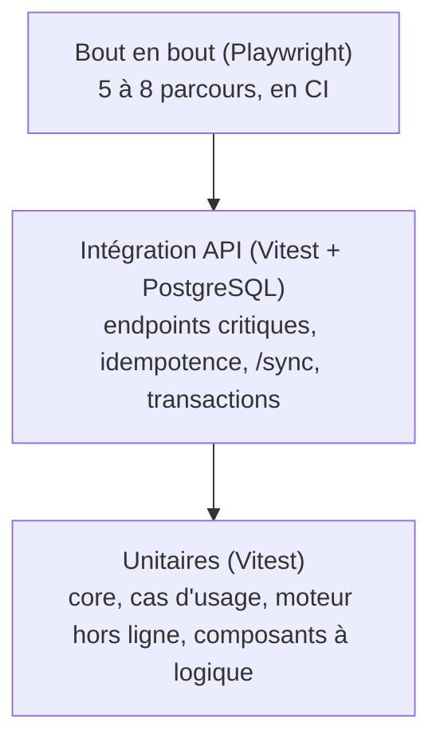

# 12 · Tests et qualité

Exigences du cahier des charges (§9) : tests unitaires du matching et des Proof XP ; tests de bout en bout du parcours SOS Dev et du hors ligne ; une PR relue par un autre membre avant fusion. Critère commun : **chaque fonctionnalité P0 est testable par une personne extérieure en moins de 2 minutes, sur l'URL de démo, sans explication** (§5).

## Stratégie : où mettre l'effort

Vingt jours, c'est court. On teste **fort** là où une erreur coûte cher et se voit en démo, et **léger** ailleurs.

| Zone                                                        | Pourquoi c'est critique                                           | Niveau de test visé                                                                               |
| ----------------------------------------------------------- | ----------------------------------------------------------------- | ------------------------------------------------------------------------------------------------- |
| `packages/core` (scores, matching, XP, secrets, étiquettes) | Une formule fausse détruit la crédibilité « basée sur la preuve » | **100 % des branches**, tests unitaires exhaustifs                                                |
| Idempotence et `/sync`                                      | Un doublon ou une perte en démo hors ligne serait fatal           | Tests d'intégration avec vraie base, y compris en concurrence                                     |
| Moteur hors ligne (front)                                   | Le moment spectaculaire de la démo                                | Unitaires + Playwright hors ligne en CI + test manuel sur téléphone                               |
| Cas d'usage de `sos`, `rooms`, `reputation`                 | Le chemin critique de la démo                                     | Tests unitaires avec adaptateurs en mémoire                                                       |
| Contrôleurs, CRUD simples                                   | Peu de logique                                                    | Couverts par les tests de bout en bout                                                            |
| Composants d'interface                                      | Changent beaucoup                                                 | Tests ciblés sur les composants à logique (jauge de qualité, indicateur réseau, écran de conflit) |

## Pyramide de tests

### Unitaires

- **Outil** : Vitest dans tous les paquets (même syntaxe en front et en back).
- **Back-end** : chaque cas d'usage se teste avec des adaptateurs **en mémoire** (`InMemoryQuestionRepository`, `FakeClock`, `FakeLlmAdapter`, `FakeGithubAdapter`). Aucune base, aucun réseau.
- **Front-end** : `fake-indexeddb` pour Dexie, Testing Library pour les composants. On teste le comportement visible, pas l'état interne.

### Intégration (API)

- Base PostgreSQL réelle (service Docker en CI, `docker-compose.dev.yml` en local), migrations appliquées, données remises à zéro entre les fichiers de test.
- Requêtes HTTP réelles sur l'application NestJS (`supertest`).
- Cas obligatoires :
  - même `Idempotency-Key` envoyée deux fois → une seule ligne en base, même réponse ;
  - même clé avec un autre corps → `422` ;
  - deux requêtes **simultanées** avec la même clé → une seule exécution ;
  - lot `/sync` avec une dépendance `client:` résolue, un conflit de version et un rejet ;
  - validation d'une réponse → XP écrits dans la même transaction, plafond quotidien respecté ;
  - tentatives d'abus de X2 (vote pour soi, 3e validation de la semaine pour une même paire, compte de moins de 24 h) ;
  - masquage d'un contenu → absent des listes publiques.

### Bout en bout (Playwright)

| Parcours       | Contenu                                                                                                                                                                                | Jalon   |
| -------------- | -------------------------------------------------------------------------------------------------------------------------------------------------------------------------------------- | ------- |
| `auth.spec`    | Connexion (GitHub simulé par un faux fournisseur OAuth en CI), Passport rempli                                                                                                         | 8 oct.  |
| `sos.spec`     | Poser une question → piste IA (fausse IA) → réponse d'un second utilisateur → validation → +10 XP visibles sur le Passport                                                             | 14 oct. |
| `offline.spec` | `context.setOffline(true)` → écrire une réponse → « 1 action en attente » → recharger → l'action est toujours là → `setOffline(false)` → synchronisée → **une seule** réponse côté API | 16 oct. |
| `rooms.spec`   | Créer une salle (GitHub simulé), rejoindre, créer et prendre une tâche, la terminer                                                                                                    | 18 oct. |
| `public.spec`  | Accueil public, Passport sans compte, balises Open Graph présentes dans le HTML de `/u/:handle`                                                                                        | 19 oct. |
| `a11y.spec`    | `axe` sur les pages principales, sans violation sérieuse                                                                                                                               | 21 oct. |

Ces tests tournent en CI sur chaque PR (Chromium, émulation d'un mobile Android).

### Tests manuels obligatoires

| Quand             | Quoi                                                                                                |
| ----------------- | --------------------------------------------------------------------------------------------------- |
| Jalon 3 (16 oct.) | Parcours hors ligne sur un **vrai téléphone Android d'entrée de gamme**, mode avion, puis 3G réelle |
| 21 et 23 oct.     | Démo complète jouée sur l'URL de production                                                         |
| 23 oct.           | Test par **une personne extérieure à l'équipe**, sans explication (§15)                             |
| Avant le jour J   | Test hors ligne répété **trois fois** (§12)                                                         |

## Qualité statique

| Outil                                      | Rôle                                                                                         | Bloquant en CI                                   |
| ------------------------------------------ | -------------------------------------------------------------------------------------------- | ------------------------------------------------ |
| TypeScript `strict`                        | Types                                                                                        | Oui                                              |
| ESLint (règles partagées `@devhub/config`) | Bugs courants, règles d'import entre couches et entre fonctionnalités, chaînes non traduites | Oui                                              |
| Prettier                                   | Formatage (jamais discuté en revue)                                                          | Oui (`--check`)                                  |
| gitleaks                                   | Secrets commités                                                                             | Oui                                              |
| `pnpm audit --prod`                        | Vulnérabilités hautes ou critiques                                                           | Oui                                              |
| Taille des bundles (`size-limit`)          | Budget de 300 Ko pour l'accueil                                                              | Oui                                              |
| Lighthouse CI                              | PWA et performance ≥ 90                                                                      | Avertissement jusqu'au 19 oct., bloquant ensuite |

Hooks locaux (Husky + lint-staged) : Prettier et ESLint sur les fichiers modifiés, gitleaks, et vérification du format de message de commit (commitlint). Ils évitent les allers-retours avec la CI ; la CI reste la référence.

## Couverture

Pas d'objectif global (il pousse à tester ce qui est facile). Objectifs ciblés :

- `packages/core` : 100 % des branches, bloquant.
- `modules/{sos,matching,reputation,sync}/application` : 90 % des lignes, avertissement.
- Le reste : pas d'objectif chiffré ; la revue vérifie que chaque correction de bug arrive avec le test qui l'aurait détectée.

## Données de test

- **Fabriques** (`test/factories.ts`) pour créer des utilisateurs, questions et salles cohérents en une ligne.
- **Faux fournisseur OAuth** en CI et en local (`AUTH_FAKE_PROVIDER=true`), **jamais** activable en production : l'application refuse de démarrer si cette variable est vraie avec `NODE_ENV=production`.
- Comptes de démonstration créés par `prisma/seed.ts`, toujours `is_demo = true`.
